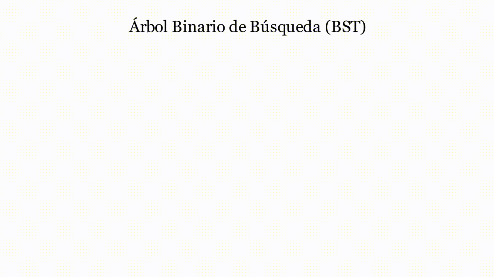
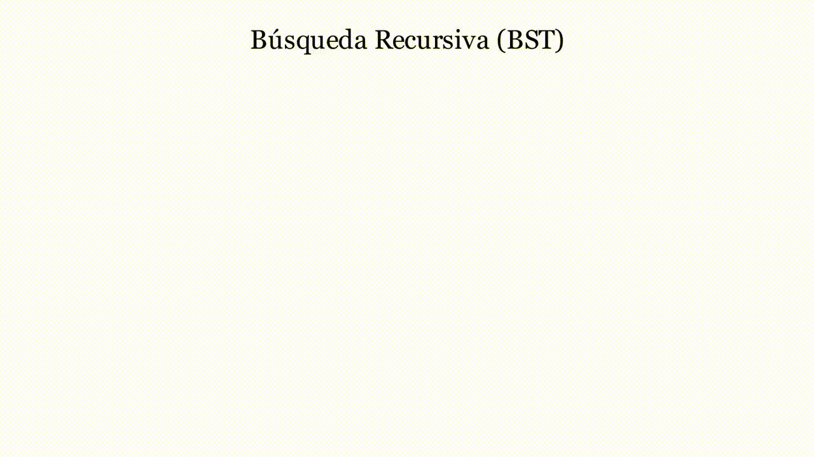

# Manim Scientific Visualize

Private workspace for **PDF → animated solution video** production and the scientific animation
library behind it (ManimCE). Everything needed to take a customer's worksheet PDF and return a
verified, narrated-by-the-page `.mp4` lives here.

| Folder | What it is |
|---|---|
| [`pdf2video/`](pdf2video/) | The engine: PDF reader (text layer + OCR), problem segmentation, solution-spec validator (SymPy, safe expressions), generic ManimCE renderer, video QA, CLI, tests and worked examples in four subjects |
| [`skills/`](skills/) | Claude skills that drive production: `pdf-document-to-solution-video` (this pipeline), `hybrid-science-animation`, `class-video-audit-and-pack` |
| [`saas/`](saas/) | Web service design for selling the conversion online (API, job queue, credits, database schema) |
| [`libs/bonemotion/`](libs/bonemotion/) | Skeleton character animation library (natural motion, IK, anticipation/follow-through) |
| `Computer_science/`, `Core/`, `Engineering/` | Lesson scenes (data structures, statics, fluid dynamics) |
| [`gallery/`](gallery/) | GIF previews used below |
| `docs/`, `render_jobs/`, `published_renders/` | Delivery protocol, CI render jobs and earlier published renders |
| [`docs/REPO_MAINTENANCE.md`](docs/REPO_MAINTENANCE.md) | Making the repo private and archiving old delivery branches as tags |

## PDF → solution video in four commands

```bash
cd pdf2video
pip install -r requirements.txt            # + system: ffmpeg, LaTeX (dvisvgm), tesseract-ocr
python -m pdf2video analyze customer.pdf --out jobs/acme   # IR + detected problems -> jobs/acme/ir.json
# write jobs/acme/spec.json from ir.json (Claude, with prompts/spec_author.md)
python -m pdf2video validate jobs/acme/spec.json           # every quote located, every number recomputed
python -m pdf2video run jobs/acme/spec.json --name acme    # validate -> render 1080p30 -> QA -> share copy
```

Worked examples (inputs, specs and QA reports) are in [`pdf2video/examples/`](pdf2video/examples/):
kinematics, algebra, statistics, stoichiometry + geometry, and a scanned (image-only) copy read with OCR.

---

# Lesson animation gallery

## 🌟 Core Research & Modules

### 1. Fluid Dynamics (PIV & GWVT)
Visual validation of research on **Gravitational Vortex Turbines (GWVT)**.
* **NumPy Integration:** Native processing of experimental *Particle Image Velocimetry* (PIV) vector fields from `.npy` files.
* **Flow Reconstruction:** Dynamic streamline implementation to validate velocity profiles and vortex core stability.

### 2. Statics & Structural Mechanics

* **Vector Mechanics:** 3D isometric rendering of machine components, spatial vector decomposition, and multi-body equilibrium (Clamps, Drums, and Pins).

<p align="center">
  
</p>

* **Centroid Analysis:** Parametric tracking of composite shapes' centers of mass with real-time coordinate updates.

<p align="center">
  
</p>

<p align="center">
  
</p>

### 3. Computer Science & Software Theory
Visual "white-box" analysis of code execution and memory management.
## 🌀 Iterative and Recursive Algorithms

<p align="center">
  
</p>

<p align="center">
  
</p>


* **Memory & Pointers:** Low-level visualization of stack/heap allocation, pointer arithmetic, and modern C++ smart pointers (`unique_ptr`, `shared_ptr`).

<p align="center">
  
</p>


* **Data Structures:** List

 <p align="center">
  
</p>

<p align="center">
  
</p>

<p align="center">
  
</p>

<p align="center">
  
</p>
 

* **Arboles:** 

<p align="center">
  
</p>

<p align="center">
  
</p>

<p align="center">
  
</p>
---


## 📂 Meticulous Project Structure

```text
/
├── 📂 core/                    # Visualization Engine (The Library)
│   ├── visual_engine.py        # Academic themes, Consoles, and Code cursors
│   ├── software_tools.py       # UML generators and Data Structure nodes
│   └── physics_tools.py        # PIV parsers, Beam loads, and 3D Vectors
├── 📂 engineering/             # Physics-Based Applications
│   ├── 📂 fluid_research/      # GWVT Thesis & PIV dataset processing
│   ├── 📂 statics_mechanics/   # Vector systems, Beams, and Equilibrium
│   └── 📂 centroids_geometry/  # Parametric center of mass analysis
├── 📂 computer_science/        # Software & Algorithmic Theory
│   ├── 📂 memory_pointers/     # Memory management and pointer logic
│   ├── 📂 data_structures/     # Linear/Non-linear structures implementation
│   └── 📂 oop_series/          # Inheritance, Polymorphism, and UML design
├── 📂 assets/                  # Scientific datasets (.npy), SVGs, and Images
└── README.md                   # Master Documentation


